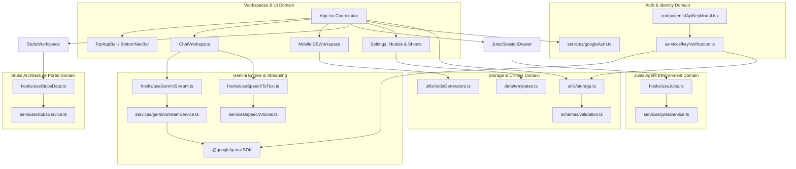

# Project Architecture Context Map

## Purpose & Overview
**AI Studio Mobile** is a responsive, mobile-first Google AI Studio prompt engineering environment and playground built with React 19, TypeScript, Vite, Tailwind CSS, and the `@google/genai` SDK. It empowers developers and prompt designers to experiment with Gemini models (Gemini 2.5 Flash, Gemini Pro, Thinking models, Vision, and Audio) with real-time streaming, speech-to-text, prompt templates, structured output JSON schema validation, and multi-language code export.

## Domain Index & Architecture Map

| Domain | Subsystem / Responsibility | Context Map |
| :--- | :--- | :--- |
| **Auth & Identity** | Google OAuth 2.0, API key persistence, validation against GenAI API | [Auth Domain Map](domains/auth-domain-map.md) |
| **Workspaces & UI** | Chat, Freeform, Structured, and Mobile IDE prompt interfaces, navigation, settings | [Workspaces Domain Map](domains/workspaces-domain-map.md) |
| **Stubs Architecture Portal** | Interactive dependency graph and Stubs CLI API integration | [Stubs Domain Map](domains/stubs-domain-map.md) |
| **Jules Agent Environment** | Autonomous coding agent session execution and PR review UI | [Jules Domain Map](domains/jules-domain-map.md) |
| **Gemini Engine & Streaming** | `@google/genai` SDK streaming engine, speech-to-text, audio voices, image compression | [Gemini Engine Domain Map](domains/gemini-engine-domain-map.md) |
| **Storage, Schemas & Utilities** | LocalStorage state, Zod schemas, starter templates, multi-language code export | [Storage & Schemas Domain Map](domains/data-storage-domain-map.md) |

---

## High-Level Subsystem Communication Graph

<!-- BEGIN STUBS DIAGRAM -->

<!-- END STUBS DIAGRAM -->

---

## Architectural Hotspots & Hubs Analysis

Based on the `stubs` SQLite dependency graph analysis (51 modules, 132 exported symbols, 165 graph edges), the following nodes act as core hubs:

1. **`src/App.tsx`** (Fan-In: 1, Fan-Out: 27, Degree: 28): Root presentation coordinator connecting all workspaces, modal sheets, and reactive hooks.
2. **`src/types.ts`** (Fan-In: 26, Fan-Out: 0, Degree: 26): Universal contract type registry defining `ChatMessage`, `PromptConfig`, `SavedPrompt`, and `ModelInfo`.
3. **`src/components/UnifiedSettingsModal.tsx`** (Fan-In: 4, Fan-Out: 10, Degree: 14): Global settings manager handling credentials, prompt parameters, and preferences.
4. **`src/components/ChatWorkspace.tsx`** (Fan-In: 1, Fan-Out: 11, Degree: 12): Primary conversational interface driving multimodal streams and voice interactions.
5. **`src/utils/storage.ts`** (Fan-In: 8, Fan-Out: 2, Degree: 10): Central persistence hub for local state and prompt synchronization.
6. **`src/components/TopAppBar.tsx`** (Fan-In: 1, Fan-Out: 7, Degree: 8): Primary action bar driving model selection and drawer toggles.

> **Verification Status**:
> - Circular dependency cycles: **0** (PASSED - DAG verified)
> - Downward layer violations: **0** (PASSED - strict hierarchy verified)
> - Domain boundary leaks: **0** (PASSED - encapsulated public interfaces)
