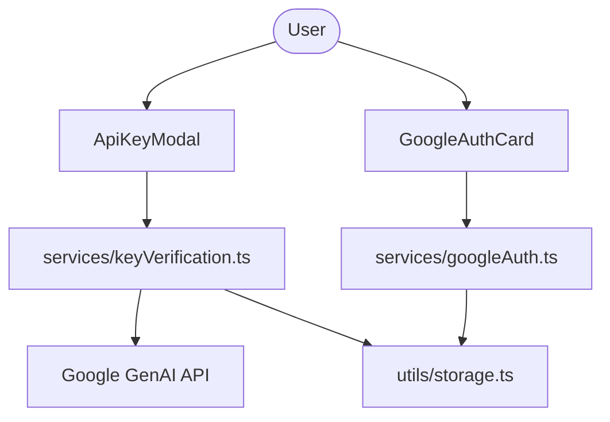

# Auth & Identity — Domain Context Map

[← Back to Root Context Map](../context-map.md)

## Domain Overview & Responsibilities
The **Auth & Identity** domain manages user identity, Google OAuth integration, Gemini API key persistence, and Google AI Studio project synchronization.

### Key Invariants:
1. **Local-First / Secure Storage**: API keys are securely persisted locally and validated before full studio features are unlocked.
2. **Flexible Auth Flow**: Supports browser redirect Google OAuth as well as manual API key input.
3. **Reactive State**: Key verification and auth state reactively notify workspaces and modals.

## Key Files & Modules

| File | Purpose & Exported Symbols | Depends On |
| :--- | :--- | :--- |
| [`src/services/auth.ts`](../../src/services/auth.ts) | Core authentication handlers and token verification logic | `types.ts`, `storage.ts` |
| [`src/services/auth.test.ts`](../../src/services/auth.test.ts) | Unit tests for auth helpers and mode resolution | `auth.ts` |
| [`src/services/googleAuth.ts`](../../src/services/googleAuth.ts) | Google OAuth 2.0 flow and token exchange handlers | `types.ts`, `storage.ts` |
| [`src/services/keyVerification.ts`](../../src/services/keyVerification.ts) | Validates Gemini API keys against the Google GenAI backend | `@google/genai`, `types.ts` |
| [`src/services/keyVerification.test.ts`](../../src/services/keyVerification.test.ts) | Verification and key ingestion test suite | `keyVerification.ts`, `storage.ts` |
| [`src/components/ApiKeyModal.tsx`](../../src/components/ApiKeyModal.tsx) | Modal UI dialog for key entry, scanning, and validation | `keyVerification.ts`, `storage.ts`, `GoogleAuthCard.tsx` |
| [`src/components/GoogleAuthCard.tsx`](../../src/components/GoogleAuthCard.tsx) | Google sign-in UI presentation card | `googleAuth.ts`, `types.ts` |
| [`src/hooks/useClipboardKeySniffer.ts`](../../src/hooks/useClipboardKeySniffer.ts) | Helper hook to sniff potential Gemini API keys from clipboard | `keyVerification.ts` |
| [`src/hooks/useWindowSecurity.ts`](../../src/hooks/useWindowSecurity.ts) | Window security and OAuth popup lifecycle management | `react`, `storage.ts` |

## Domain Architecture & Flow

