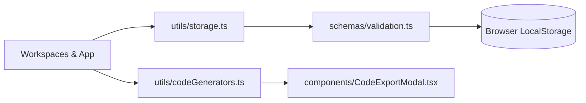

# Storage, Schemas & Utilities — Domain Context Map

[← Back to Root Context Map](../context-map.md)

## Domain Overview & Responsibilities
The **Storage, Schemas & Utilities** domain provides persistent state management across reloads, strict runtime schema validation via Zod, starter prompt templates, and multi-language code export generators (cURL, Python, JS/TS).

### Key Invariants:
1. **Schema Validation**: All stored prompts, imported JSON projects, and request bodies are guarded by Zod schemas.
2. **Deterministic Serialization**: Prompt configurations and messages serialize cleanly to `localStorage` with migration support.
3. **Multi-Platform Code Export**: Accurate snippet synthesis for `@google/genai` across curl, Python, and JavaScript/TypeScript.

## Key Files & Modules

| File | Purpose & Exported Symbols | Depends On |
| :--- | :--- | :--- |
| [`src/utils/storage.ts`](../../src/utils/storage.ts) | LocalStorage access layer for saved prompts, active session, API key, and user profile | `types.ts`, `schemas/validation.ts` |
| [`src/utils/storage.test.ts`](../../src/utils/storage.test.ts) | Unit tests for storage serialization, draft recovery, and schema upgrades | `storage.ts` |
| [`src/schemas/validation.ts`](../../src/schemas/validation.ts) | Zod validation schemas for prompts, configurations, messages, and API schemas | `zod` |
| [`src/schemas/validation.test.ts`](../../src/schemas/validation.test.ts) | Runtime schema validation test suite | `validation.ts` |
| [`src/data/templates.ts`](../../src/data/templates.ts) | Curated collection of prompt templates for chat, code, reasoning, and vision | `types.ts` |
| [`src/utils/codeGenerators.ts`](../../src/utils/codeGenerators.ts) | Code generator creating cURL, Python, and Node.js SDK request snippets | `types.ts` |
| [`src/utils/codeGenerators.test.ts`](../../src/utils/codeGenerators.test.ts) | Snapshot tests for generated code across Kotlin, TS, Python, and cURL | `codeGenerators.ts` |
| [`src/components/CodeExportModal.tsx`](../../src/components/CodeExportModal.tsx) | Dialog presenting generated code snippets with one-tap copy and language switcher | `codeGenerators.ts`, `types.ts` |
| [`src/components/ImportProjectSheet.tsx`](../../src/components/ImportProjectSheet.tsx) | Bottom sheet for importing/exporting full AI Studio JSON project configurations | `storage.ts`, `keyVerification.ts`, `types.ts` |

## Domain Architecture & Flow

