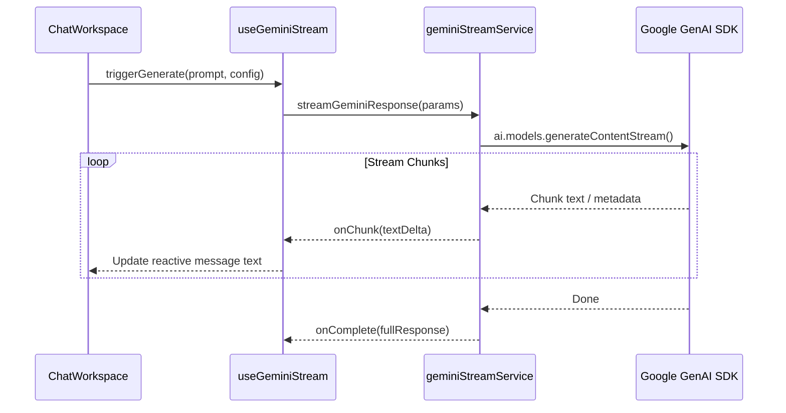

# Gemini Engine & Streaming — Domain Context Map

[← Back to Root Context Map](../context-map.md)

## Domain Overview & Responsibilities
The **Gemini Engine & Streaming** domain handles direct communication with Google's `@google/genai` SDK, full Server-Sent Events / chunked response streaming, multimodal payload encoding, and audio/voice interactions.

### Key Invariants:
1. **Streaming Stability**: Error boundaries and retry semantics preserve partial chat bubbles during network disruptions.
2. **Multimodal Ingestion**: Automated client-side image compression before inline data transfer.
3. **Voice & Audio Pipeline**: Real-time speech recognition hook paired with voice preference settings and synthesis extractor.

## Key Files & Modules

| File | Purpose & Exported Symbols | Depends On |
| :--- | :--- | :--- |
| [`src/services/geminiStreamService.ts`](file:///Users/lappier/code/projects/ai-studio-mobile/src/services/geminiStreamService.ts) | Core Gemini client streaming engine (`streamGeminiResponse`) | `@google/genai`, `types.ts` |
| [`src/hooks/useGeminiStream.ts`](file:///Users/lappier/code/projects/ai-studio-mobile/src/hooks/useGeminiStream.ts) | React hook wrapping stream state, abort controllers, and accumulation | `geminiStreamService.ts` |
| [`src/hooks/useSpeechToText.ts`](file:///Users/lappier/code/projects/ai-studio-mobile/src/hooks/useSpeechToText.ts) | Browser SpeechRecognition API wrapper with silence detection | `speechVoices.ts` |
| [`src/services/speechVoices.ts`](file:///Users/lappier/code/projects/ai-studio-mobile/src/services/speechVoices.ts) | Synthesizes speech audio and voice selections | `types.ts` |
| [`src/utils/speechExtractor.ts`](file:///Users/lappier/code/projects/ai-studio-mobile/src/utils/speechExtractor.ts) | Cleans and normalizes markdown/code text for text-to-speech reading | `utils` |
| [`src/utils/imageCompressor.ts`](file:///Users/lappier/code/projects/ai-studio-mobile/src/utils/imageCompressor.ts) | Downsamples user images on canvas to maintain low token footprints | Browser Canvas |
| [`src/components/TokenCounterVisualization.tsx`](file:///Users/lappier/code/projects/ai-studio-mobile/src/components/TokenCounterVisualization.tsx) | Live visual gauge estimating prompt token usage vs context limit | `types.ts` |

## Domain Architecture & Flow

