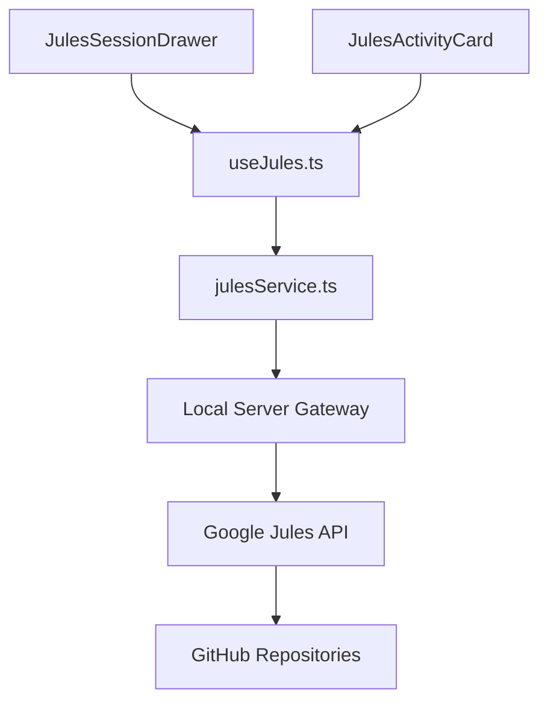

# Jules Agent Environment — Domain Context Map

[← Back to Root Context Map](../context-map.md)

## Domain Overview & Responsibilities
The **Jules Agent Environment** domain acts as a dedicated environment for interacting with the Google Jules (`jules.google.com`) API. It brings multi-turn, autonomous coding agent workflows into the mobile device, connecting to GitHub repositories and allowing users to monitor execution plans, approve steps, and review pull requests within the application UI.

### Key Invariants:
1. **GitHub Repository Sessions**: Agent runs are strongly bound to an explicit session mapping `repository` + `branch`.
2. **Proxy Gateway Security**: Live Jules API requests are proxied via the `server.ts` Node backend to avoid exposing credentials to the client.
3. **Adaptive Polling Engine**: Monitors remote execution processes reliably on constrained mobile network profiles via a short-interval 2.5s polling heartbeat.

## Key Files & Modules

| File | Purpose & Exported Symbols | Depends On |
| :--- | :--- | :--- |
| [`src/components/JulesSessionDrawer.tsx`](../../src/components/JulesSessionDrawer.tsx) | Primary modal slide-over for selecting GitHub repositories and switching Jules task sessions | `useJules.ts`, `types.ts` |
| [`src/components/JulesActivityCard.tsx`](../../src/components/JulesActivityCard.tsx) | Distinctive chat message card rendering current plan steps, diffs, or PR status in the conversational log | `lucide-react`, `types.ts` |
| [`src/hooks/useJules.ts`](../../src/hooks/useJules.ts) | React hook wrapping the execution loop, active state polling, and message appending for Jules workflows | `julesService.ts`, `types.ts` |
| [`src/services/julesService.ts`](../../src/services/julesService.ts) | Core frontend client executing commands through the `server.ts` Jules proxy gateway | `apiClient.ts`, `types.ts` |
| [`src/services/julesService.ts.md`](../../src/services/julesService.ts.md) | Spec sidecar documenting architectural boundaries and phase execution tracker | - |

## Domain Architecture & Flow

