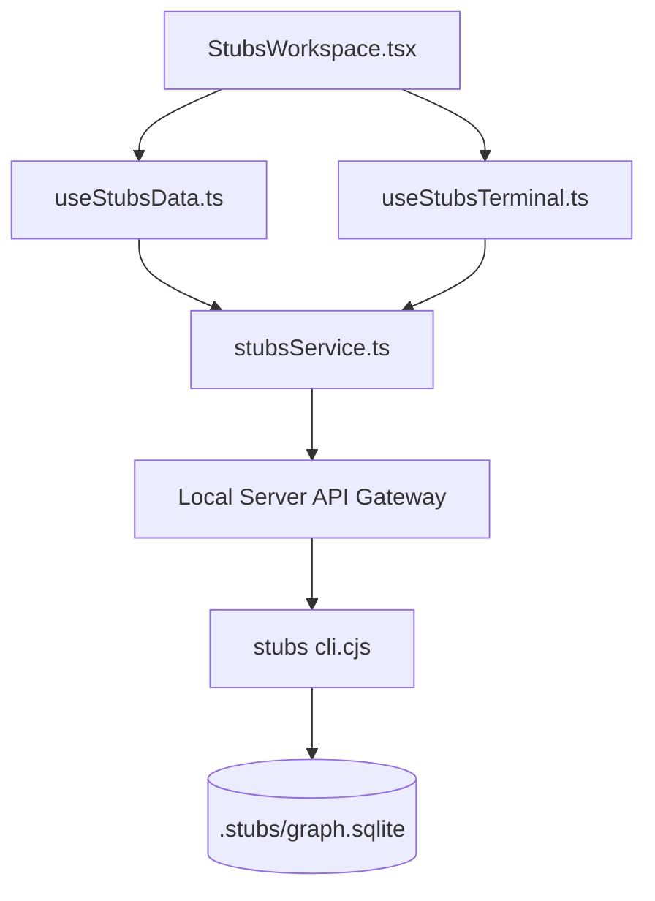

# Stubs Architecture Portal — Domain Context Map

[← Back to Root Context Map](../context-map.md)

## Domain Overview & Responsibilities
The **Stubs Architecture Portal** domain provides an in-app viewer and toolchain for executing the `.agents/skills/stubs` architecture CLI from within the AI Studio Mobile environment. It surfaces interactive Mermaid dependency diagrams, architectural linting reports, blast radius inspections, and sidecar spec `.ts.md` integrations.

### Key Invariants:
1. **Isolated Data Model**: Operates entirely over the `StubsGraphData` structure, decoupled from the active chat mode.
2. **Server-Side Execution**: Employs HTTP proxy to a local server-side instance to execute parsing (via SQLite intermediate graph representation).
3. **SSE Streaming**: Surfaces `cli.cjs` execution logs sequentially to the mobile portal through Server-Sent Events (SSE).

## Key Files & Modules

| File | Purpose & Exported Symbols | Depends On |
| :--- | :--- | :--- |
| [`src/components/StubsWorkspace.tsx`](../../src/components/StubsWorkspace.tsx) | Primary workspace for viewing the dependency graph and launching Stubs CLI actions | `useStubsData.ts`, `useStubsSpecs.ts`, `useStubsTerminal.ts` |
| [`src/hooks/stubs/useStubsData.ts`](../../src/hooks/stubs/useStubsData.ts) | React hook wrapping backend fetching of graph and linting data | `stubsService.ts` |
| [`src/hooks/stubs/useStubsSpecs.ts`](../../src/hooks/stubs/useStubsSpecs.ts) | React hook wrapping backend fetching of markdown sidecar specifications | `stubsService.ts` |
| [`src/hooks/stubs/useStubsTerminal.ts`](../../src/hooks/stubs/useStubsTerminal.ts) | React hook for managing the SSE log terminal connection | `stubsService.ts` |
| [`src/services/stubsService.ts`](../../src/services/stubsService.ts) | Proxy client calling local backend routes to execute architecture checks and diagrams | `apiClient.ts`, `types.ts` |

## Domain Architecture & Flow

