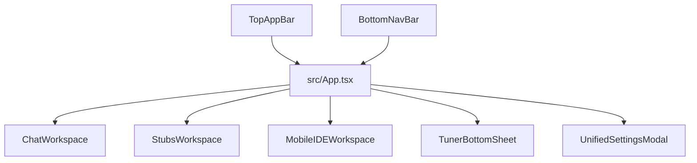

# Workspaces & UI — Domain Context Map

[← Back to Root Context Map](../context-map.md)

## Domain Overview & Responsibilities
The **Workspaces & UI** domain constitutes the interactive prompt engineering environment for mobile devices, offering three prompt modes: **Chat**, **Mobile IDE**, and **Stubs**.

### Key Invariants:
1. **Responsive Mobile Shell**: Supports Android frame simulations, bottom navigation, and top action bars.
2. **Unified Settings**: Global tuner controls (temperature, topP, topK, system instructions) synchronizing with active workspace mode.
3. **PWA & Device Ready**: Offline awareness via network hooks, privacy shield, and gesture-friendly sheets.

## Key Files & Modules

| File | Purpose & Exported Symbols | Depends On |
| :--- | :--- | :--- |
| [`src/App.tsx`](../../src/App.tsx) | Central coordinator component binding state, workspaces, and navigation | Workspaces, Services, Hooks |
| [`src/components/ChatWorkspace.tsx`](../../src/components/ChatWorkspace.tsx) | Multi-turn conversational chat UI with streaming and markdown rendering | `useGeminiStream`, `storage.ts`, `speechVoices.ts` |
| [`src/components/StubsWorkspace.tsx`](../../src/components/StubsWorkspace.tsx) | Architecture-as-Code PWM Portal | `types.ts` |
| [`src/components/MobileIDEWorkspace.tsx`](../../src/components/MobileIDEWorkspace.tsx) | Code generation and preview environment with export capabilities | `codeGenerators.ts`, `CodeExportModal` |
| [`src/components/PromptTemplateDrawer.tsx`](../../src/components/PromptTemplateDrawer.tsx) | Bottom sheet for inserting templates, composing variables, and few-shot examples | `data/templates.ts`, `promptTemplateService.ts` |
| [`src/components/prompt-tools/FewShotBuilderTool.tsx`](../../src/components/prompt-tools/FewShotBuilderTool.tsx) | Tooling for building structured few-shot prompt examples | `types.ts` |
| [`src/components/prompt-tools/VariablePromptTool.tsx`](../../src/components/prompt-tools/VariablePromptTool.tsx) | Tooling for mustache-style prompt variables | `types.ts` |
| [`src/components/MobileIDE.test.ts`](../../src/components/MobileIDE.test.ts) | Unit tests for mobile IDE mode resolution and code generator triggers | `MobileIDEWorkspace.tsx` |
| [`src/components/TopAppBar.tsx`](../../src/components/TopAppBar.tsx) | App header with model picker, project indicator, and modal triggers | `types.ts`, `lucide-react` |
| [`src/components/BottomNavBar.tsx`](../../src/components/BottomNavBar.tsx) | Mobile bottom bar navigation between workspaces | `types.ts` |
| [`src/components/TunerBottomSheet.tsx`](../../src/components/TunerBottomSheet.tsx) | Parameter slider drawer (temperature, topP, topK, schema) | `types.ts` |
| [`src/components/UnifiedSettingsModal.tsx`](../../src/components/UnifiedSettingsModal.tsx) | Comprehensive settings dialog (storage, auth, preferences) | `storage.ts`, `auth.ts` |
| [`src/components/AndroidFrame.tsx`](../../src/components/AndroidFrame.tsx) | Realistic Android hardware bezel preview container for desktop viewport | `types.ts` |
| [`src/components/CustomTabBrowserModal.tsx`](../../src/components/CustomTabBrowserModal.tsx) | In-app Chrome Custom Tab simulation for OAuth and documentation | `keyVerification.ts` |
| [`src/components/DesktopWrapperGuide.tsx`](../../src/components/DesktopWrapperGuide.tsx) | Visual guidance card helping desktop developers emulate mobile workflows | `lucide-react` |
| [`src/components/LibraryModal.tsx`](../../src/components/LibraryModal.tsx) | Prompt library browser for saving, organizing, and loading prompts | `data/templates.ts`, `storage.ts` |
| [`src/components/RightDrawerMenu.tsx`](../../src/components/RightDrawerMenu.tsx) | Slide-over drawer offering quick actions, doc links, and settings access | `UnifiedSettingsModal.tsx` |
| [`src/components/SecurePrivacyShield.tsx`](../../src/components/SecurePrivacyShield.tsx) | Privacy and network security banner reassuring user of local data safety | `lucide-react` |
| [`src/hooks/useBackNavigation.ts`](../../src/hooks/useBackNavigation.ts) | React hook intercepting android back button presses | `react` |
| [`src/hooks/useNetworkStatus.ts`](../../src/hooks/useNetworkStatus.ts) | PWA reactive network status hook | `react` |
| [`src/hooks/usePWAInstall.ts`](../../src/hooks/usePWAInstall.ts) | PWA 'beforeinstallprompt' hook | `react` |

## Domain Architecture & Flow

