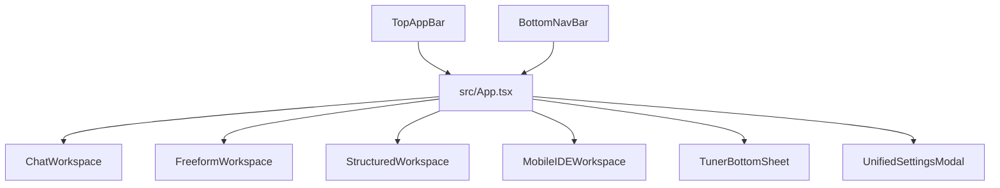

# Workspaces & UI — Domain Context Map

[← Back to Root Context Map](../context-map.md)

## Domain Overview & Responsibilities
The **Workspaces & UI** domain constitutes the interactive prompt engineering environment for mobile devices, offering four prompt modes: **Chat**, **Freeform**, **Structured**, and **Mobile IDE**.

### Key Invariants:
1. **Responsive Mobile Shell**: Supports Android frame simulations, bottom navigation, and top action bars.
2. **Unified Settings**: Global tuner controls (temperature, topP, topK, system instructions) synchronizing with active workspace mode.
3. **PWA & Device Ready**: Offline awareness via network hooks, privacy shield, and gesture-friendly sheets.

## Key Files & Modules

| File | Purpose & Exported Symbols | Depends On |
| :--- | :--- | :--- |
| [`src/App.tsx`](file:///Users/lappier/code/projects/ai-studio-mobile/src/App.tsx) | Central coordinator component binding state, workspaces, and navigation | Workspaces, Services, Hooks |
| [`src/components/ChatWorkspace.tsx`](file:///Users/lappier/code/projects/ai-studio-mobile/src/components/ChatWorkspace.tsx) | Multi-turn conversational chat UI with streaming and markdown rendering | `useGeminiStream`, `storage.ts` |
| [`src/components/FreeformWorkspace.tsx`](file:///Users/lappier/code/projects/ai-studio-mobile/src/components/FreeformWorkspace.tsx) | Unconstrained prompt scratchpad with token counter and insertion tools | `TokenCounterVisualization` |
| [`src/components/StructuredWorkspace.tsx`](file:///Users/lappier/code/projects/ai-studio-mobile/src/components/StructuredWorkspace.tsx) | Few-shot table-based input/output pair prompt builder | `types.ts` |
| [`src/components/MobileIDEWorkspace.tsx`](file:///Users/lappier/code/projects/ai-studio-mobile/src/components/MobileIDEWorkspace.tsx) | Code generation and preview environment with export capabilities | `codeGenerators.ts`, `CodeExportModal` |
| [`src/components/TopAppBar.tsx`](file:///Users/lappier/code/projects/ai-studio-mobile/src/components/TopAppBar.tsx) | App header with model picker, project indicator, and modal triggers | `types.ts`, `lucide-react` |
| [`src/components/BottomNavBar.tsx`](file:///Users/lappier/code/projects/ai-studio-mobile/src/components/BottomNavBar.tsx) | Mobile bottom bar navigation between workspaces | `types.ts` |
| [`src/components/TunerBottomSheet.tsx`](file:///Users/lappier/code/projects/ai-studio-mobile/src/components/TunerBottomSheet.tsx) | Parameter slider drawer (temperature, topP, topK, schema) | `types.ts` |
| [`src/components/UnifiedSettingsModal.tsx`](file:///Users/lappier/code/projects/ai-studio-mobile/src/components/UnifiedSettingsModal.tsx) | Comprehensive settings dialog (storage, auth, preferences) | `storage.ts`, `auth.ts` |

## Domain Architecture & Flow

